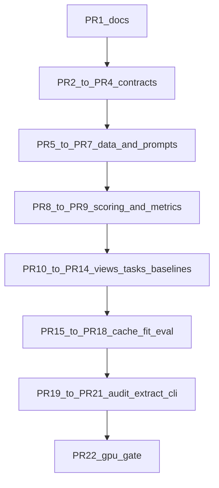

# Bite-size implementation pull requests

The repository is an empty `main` branch with two untracked specifications: [implementation_plan.tex](implementation_plan.tex) and [readme.tex](readme.tex). There is no package, remote, or pipeline code. The six milestones in the implementation plan are too large to review line by line, so each pull request below is one contract plus the tests that lock it.

## Review process

- Implement and open one pull request, then stop. The next slice starts only after review comments on that diff are resolved.
- Each pull request contains its production code and its tests. A reviewer should be able to read every new line.
- If a slice grows past about 400 lines of new Python, excluding fixture data, split it before opening the pull request.
- The pull-request body will list the specification sentences that diff must satisfy, so review is a check against [implementation_plan.tex](implementation_plan.tex), not a style pass.
- There is no Git remote yet. Branches stay local until a remote exists; nothing is pushed unless you ask.
- Every slice stays inside the initial capability matrix. MMLU, other models, teacher forcing, stacked probes, new losses, confidence intervals, and retrieval or generation remain unimplemented interfaces.

## Pull-request sequence

**PR 1 — Record the specifications.** Commit only [implementation_plan.tex](implementation_plan.tex) and [readme.tex](readme.tex). Review that this baseline contains no empirical counts and no pipeline code.

**PR 2 — Package skeleton and domain errors.** Add `pyproject.toml` and `src/knowledge_recovery/errors.py` with the named exceptions: `TokenAuditRequired`, `CanonicalTokenNotSingle`, `AnswerInstructionMismatch`, `UnsupportedPositionSelector`, `MissingLocalAsset`, `CacheIncompatible`, and `CacheIncomplete`. `cli.py` only dispatches and contains no scientific logic. Review the exception names and the messages a later caller must be able to show, including changed-field names for the token audit.

**PR 3 — Records and canonical hashes.** Add `records.py` and `provenance.py`. Implement versioned canonical JSON and `H = SHA-256(UTF-8(canonical JSON))`, plus the separate constructors for model, prompt, extraction, row, view, run, and evaluation identities. Review that dictionary keys are sorted, array order is preserved, nonfinite numbers are rejected, and Python's built-in hash is unused. The extraction row key contains only model, prompt, and extraction signatures. It must not contain `run_id`, `eval_id`, split seed, batch size, hostname, or ECE settings.

**PR 4 — Typed configuration.** Add `config.py` and `configs/initial_sycophancy.yaml` as three objects: extraction, analysis view, and probe run. Reject unknown keys and require schema versions. Review that chat and the literal system message are explicit, precision has no silent fallback, and offline mode cannot download assets. Paths are checked before any expensive work; a missing storage root fails rather than writing into the repository. The filter threshold is a strict lower bound, not a raw-versus-canonical choice.

**PR 5 — Sycophancy normalization.** Add `datasets/base.py` and `datasets/sycophancy.py`. Keep rows whose `prompt_template` is exactly `{question}`, read only `base.question`, `base.correct_answer`, and `base.incorrect_answer`, and hash the exact question text into a base-group ID. Review the fixture counts: other templates are counted and ignored, empty strings and equal answers are rejected, identical triples collapse with every source row ID retained, and conflicting answers for one question stop preparation. The adapter does not split or call a model.

**PR 6 — Intervention materialization.** Add the provider protocol, registry, identity provider, the four template presets, supplied-text joins, and materialization manifests. Review the exact strings, including the comma before "but" in the two negative templates and its absence in the two positive templates. `{correct}` and `{incorrect}` bind to answer text, never to option letters. The same instance text is reused for both orders. Supplied text joins on `base_item_id`, and a missing or ambiguous row raises an error rather than becoming a clean prompt.

**PR 7 — Prompt rendering and placement.** Add `prompts/render.py` and `prompts/placement.py`. Review stored fixtures for clean and all four variants in both orders: LF newlines, no added quotation marks, no stripped source text, no trailing newline, and clean omitting the context block and its separator. Named slots and a character-anchor placement fail when the anchor is missing or ambiguous. Chat wrapping is represented as data here; tokenization waits for the audit pull request.

**PR 8 — Canonical scoring.** Add `answers/canonical.py` for raw A/B probabilities, canonical A/B probabilities, canonical-label mass, unrestricted greedy token ID, and canonical greedy label. Review tie behavior on a hand fixture: canonical logit ties choose A, full-vocabulary logit ties choose the smallest token ID, and scoring uses the continuation contract rather than retokenizing prompt-plus-answer.

**PR 9 — Metrics on hand-computable fixtures.** Add `evaluation/metrics.py` before any training code. Review scalar Brier `(q - r)^2` so the score is not doubled by summing both classes; cross-entropy taken from logits without clipping; an infinite-value flag when a constant 0 or 1 meets an impossible label; `K` as mean true-class probability; and ECE on 15 bins `[b/15, (b+1)/15)` with the last right endpoint included. Empty bins contribute zero. ECE confidence is the predicted probability, not the probability of the true label. Pooled ECE bins the pooled rows.

**PR 10 — Grouped splits.** Add `views/splits.py`. Sort base-group IDs lexicographically, permute with `numpy.random.Generator(numpy.random.PCG64(split_seed))`, assign floor counts to train and validation, and give the remainder to test. Review that the saved mapping is the provenance, that this seed is distinct from the probe seed, and that intervention coverage cannot change membership.

**PR 11 — Fixed filter.** Add `views/filters.py`. Apply four steps in order: the unrestricted greedy token is an option; that option's normalized A/B probability is greater than 0.8; that option is the correct label; both clean orders passed. For both orders together, for correct-at-A, and for correct-at-B, report the count before the filters and after each step. A base question is eligible only after the fourth step. There is no probability-basis decision.

**PR 12 — Behavioral tables.** Add `evaluation/behavior.py`. Review, for each split and population, correct-at-A and correct-at-B denominators, questions correct in both orders, and per-variant changed-answer counts inside that both-correct denominator. Clean deviation is zero. A zero denominator is an unavailable value with an explanatory count. Raw and canonical tables have distinct names. Paired counts satisfy set-intersection bounds.

**PR 13 — Task targets.** Add `tasks/base.py`, `tasks/agreement.py`, and `tasks/clean_answer.py`. Awareness is equality of clean and contextual canonical argmax labels, with class order `[disagree, agree]`. Consistency targets the clean canonical argmax over `[A, B]`. Review the required fixture: the unrestricted greedy token changes while the canonical argmax stays fixed, so the awareness label remains agreement and the recovery target remains the clean canonical label. Filtering changes eligibility only.

**PR 14 — Baseline methods.** Add the method registry, the awareness training-frequency method, and the knowledge-consistency contextual-answer method. Review that frequency is one scalar from the filtered training view and ignores residuals; a one-class view is a labeled degenerate probability 0 or 1; contextual answer emits that row's cached canonical distribution and has no checkpoint or layer. Passing an awareness method into the consistency task fails even when the tensor shapes match. `selected_layer` is null for both.

**PR 15 — Extraction cache.** Add `cache/keys.py`, `cache/schemas.py`, and `cache/store.py` using synthetic tensors. Review atomic shard writes, checksums, incomplete versus absent shards, and a global row-key index. A completed cache hit returns references without constructing a model. A probe-only lookup reports missing keys and does not infer. Changing reporting settings does not allocate a new extraction row.

**PR 16 — Linear probe fitting.** Add `probes/linear.py`, `training/losses.py`, and `training/fit.py` for one independent logistic model per layer. Review the `linear_v1` profile: AdamW at learning rate `1e-3`, weight decay `1e-4` on weights only, betas `(0.9, 0.999)`, epsilon `1e-8`, batch 256, at most 200 epochs, and early stopping after 20 completed epochs without a strict validation-cross-entropy decrease. Standardization uses training rows only, float64 accumulation, population standard deviation with denominator `n`, and zero-variance features replaced by 1. Initialization is uniform on `[-1/sqrt(d), 1/sqrt(d)]` from the specified SHA-256 seed stream. OOD rows never enter fitting, transforms, or the loss. This is the slice most likely to need a further split between preprocessing and the optimization loop.

**PR 17 — Checkpoint and layer selection.** Add `training/select.py`. Review that only completed-epoch checkpoints compete, an exact loss tie keeps the earliest checkpoint, and an exact layer tie keeps the shallower layer. The selection manifest is written before any test evaluation. Changing test labels does not change the selected layer. The initial protocol does not refit on train plus validation.

**PR 18 — Evaluation and export.** Add `evaluation/evaluate.py` and `reports/export.py`. Score the selected checkpoint and both baselines on ID and OOD views, and write JSON, CSV, and generated LaTeX fragments. Review that saved per-example predictions reproduce cross-entropy, Brier, `K`, and ECE with model loading and probe fitting disabled. Per-variant ECE remains beside pooled ECE. Validation layer profiles stay separate from selected-layer test metrics.

**PR 19 — Token audit.** Add `prompts/token_audit.py` and exercise it with a fake tokenizer before any Qwen weights are loaded. Review one-token continuation checks, the exact-prefix check when concatenated text is used, and `TokenAuditRequired` when model, tokenizer, chat mode, template, instruction, or answer boundary changes. A null audit field is valid in the unfilled configuration and is replaced by the audit ID in the resolved manifest. No force or skip flag bypasses the recheck. `CanonicalTokenNotSingle` does not fall back to the first or last token.

**PR 20 — Frozen extraction.** Add offline asset resolution, the Qwen adapter, last-non-padding-token selection, and the extraction runner. Unit tests use a mock module with the documented hook names. Review layer indices starting at one, embedding output excluded from layer one, and the final normalized state stored separately from the final block residual. Residuals are stored as bfloat16 and full-vocabulary logits as float32. An out-of-memory retry may lower batch size only. Cache-only commands do not require the original model files. A real local snapshot is used only when you explicitly supply its path.

**PR 21 — Command graph and compatibility tests.** Wire the stage order from the execution graph, including the fixed filter counts before training. Add the cache-compatibility matrix: split seed, training seed, split ratio, filter threshold, loss, ECE bins, and OOD variant assignment keep extraction keys unchanged; prompt, model, and position changes report a missing or incompatible artifact. A probe-only run is denied model construction and network access. Method-specific failures leave the other valid tasks reported, with an incomplete overall status.

**PR 22 — GPU integration gate.** After the code reviews, run a small explicitly labeled local subset through extraction and the fixed four-step filter. It does not stop for a raw-versus-canonical choice.

## What each review is looking for

The early pull requests exist to catch the mistakes that would invalidate later artifacts:

- PR 3 and PR 15: an analysis or training change accidentally invalidates residuals.
- PR 5 through PR 7: a field fallback, a rewritten template, or a clean prompt that still contains a context separator.
- PR 8, PR 9, and PR 13: a tie, Brier definition, or greedy-token diagnostic silently changing the training target.
- PR 11: the four steps stay in order, and step 2 uses the normalized option probability rather than the raw probability or the correct label.
- PR 14 and PR 17: shared weights, a fabricated layer, or test labels participating in selection.
